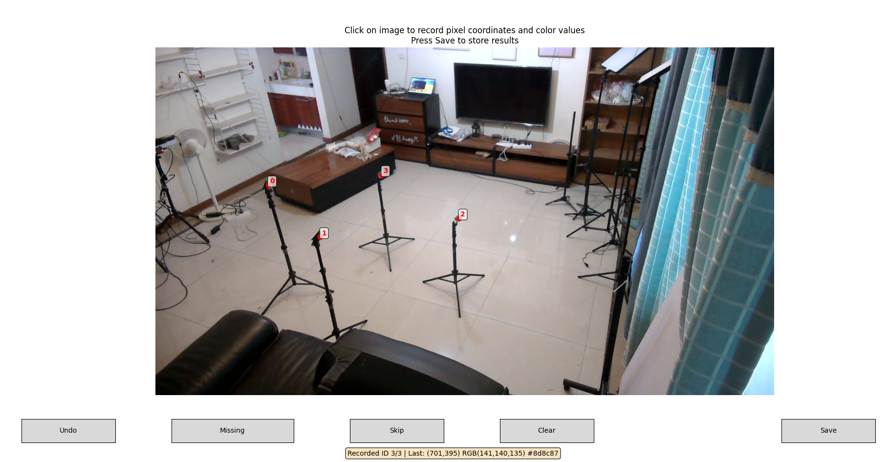

# DataProcess

用于人体感知实验的多传感器离线数据处理：通过八台相机（A–H）检测二维人体关节点、重建和平滑三维骨架，作为参考标注（GT），再与高低位雷达、激光雷达和 RealSense 点云进行时间同步、坐标对齐和可视化检查。

处理顺序：相机标定与验证 → 相机/雷达外参标定 → 图像二维检测 → 三维重建与时序后处理 → 多传感器结果检查。

## 数据与运行准备

数据按日期和采集组组织，典型目录如下：

```text
<日期目录>/
├─ calib/
│  ├─ intrinsic_cam_A.npz                    # A–H 相机内参，包含 K、dist
│  ├─ extrinsic_T_cam_B_to_cam_A.npy         # B–H 到参考相机 A 的外参
│  ├─ extrinsic_img_to_radar_low.npz
│  └─ extrinsic_img_to_radar_high.npz
└─ data_collection/
   └─ group_xxx/
      ├─ camera/
      │  ├─ cam_A/frames/<秒>_<纳秒>.jpg
      │  └─ ...                             # cam_B 至 cam_H
      ├─ dpct低位机/                          # Bin/*.bin、PC/*.npy
      ├─ dpct高位机/                          # Bin/*.bin、PC/*.npy
      ├─ robosense/                          # 激光雷达 .pcd
      ├─ realsense/aligned_depth/            # 深度点云 .bin
      └─ camera results/                     # 后续步骤生成
         ├─ 2D/cam_A/<秒>_<纳秒>.npz         # 各相机分别保存
         ├─ 3D/<秒>_<纳秒>.pkl               # 每帧多人的三维骨架
         └─ smoothed 3D/<秒>_<纳秒>.pkl      # 跟踪和平滑后的骨架
```

- 提前将本次采集对应的八台相机内参复制到 `calib/`。
- 使用已配置依赖的 Python 环境；主要依赖包括 NumPy、SciPy、OpenCV、Matplotlib、tqdm、Open3D，二维检测还需要 PyTorch、MMDetection、MMPose 和 MMEngine。交互显示需可用的图形环境，部分脚本使用 Qt5Agg。
- 二维检测所需的 RTMDet、ViTPose 配置与权重放在 `Img2Keypoint/2D_KeyPoints_helper/`，文件名以 `pipeline.py` 为准。
- 以下命令均在项目根目录运行，将示例中的 `F:\20261028` 替换为实际日期目录。各脚本内置的默认路径并不一致，运行时应显式指定路径。
- 所有运行入口均将 `parse_args(argv=None)` 放在导入之后、其他函数之前。每个参数都显式设置 `default` 和中文 `help`；运行 `python -m <模块名> --help` 可查看参数说明及默认值。默认值为 `None` 的可选路径按对应帮助说明推导。
- 新增的可视化布尔参数使用成对开关，例如 `--select_flag` 启用人体区域筛选，`--no-select_flag` 关闭；时序后处理可用 `--no-show` 关闭对比窗口。已有 `--skip_existing true|false` 等参数保持原有用法。

## 1. 相机外参获取

入口：[Calib/get_camera_extrinsic.py](Calib/get_camera_extrinsic.py)。使用棋盘格图像估计相机位姿，并联合优化重投影误差。当前棋盘配置为 **24 × 24 个内角点、方格边长 0.04 m**，应与实际标定板一致。

```powershell
python -m Calib.get_camera_extrinsic --data_path "F:\20261028\data_collection" --intrinsic_path "F:\20261028\calib" --save_path "F:\20261028\calib_verified" --reference_cam A
```

默认使用排序后的前 5 个采集组，可通过 `--selected_groups N` 调整数量。默认每组、每台相机最多使用 2 帧有效棋盘图像。

八台相机均成功参与标定时，输出目录中产生 7 个 `extrinsic_T_cam_X_to_cam_A.npy`（X 为 B–H），以及逐帧重投影误差报告 `camera_extrinsic_validation.csv`。参考相机 A 的变换为单位矩阵，无需单独保存外参文件。优化或重投影验证未通过时，脚本不会保存新外参。

默认输出目录为 `calib_verified/`，与后续步骤使用的 `calib/` 不同。验证时需将内参也复制到 `calib_verified/`；验证通过后，再将新外参复制到本次采集的 `calib/`。

## 2. 相机外参验证

入口：[Calib/check_in&ex.py](Calib/check_in%26ex.py)。`--calib_path` 必须指向同时含有内参和待验证外参的目录。

```powershell
python "Calib/check_in&ex.py" --data_path "F:\20261028\data_collection\group_005" --calib_path "F:\20261028\calib_verified" --reference_cam A
```

`--data_path` 支持单个采集组、组内 `camera/`，或包含多个组的父目录。父目录模式下可用 `--selected_groups "5,6"` 指定检查组。

命令行输出示例（仅供参考，实际误差以本次数据为准）：

```text
========== check extrinsic group=group_005 ==========
[INFO] group=group_005, used_cameras=['A', 'B', 'C', 'D', 'E', 'F', 'G', 'H'], num_valid_points=576
[INFO] mean=0.004220 m, rmse=0.004618 m, median=0.004084 m, max=0.012606 m
[INFO] plane_mean=0.000518 m, plane_rmse=0.000639 m, plane_max=0.002366 m
```

关注棋盘重建误差和共面误差，期望达到毫米或亚毫米量级，并结合有效角点数量判断。此处误差单位为米，与外参获取脚本中以像素为单位的重投影误差不同。

## 3. 相机与高低位雷达外参标定

入口：[Calib/get_R_t_between_radar_cam.py](Calib/get_R_t_between_radar_cam.py)。通过多相机重建角反射器位置，再与雷达检测点配准，求相机参考坐标系到雷达坐标系的变换。

通过命令行参数配置：

- `--root_path`：包含角反射器的采集组；选择图像和雷达均能清楚观测角反的组。可用 `--calib_path` 指定标定目录。
- `--radar_selected`：分别设为 `low`、`high` 各运行一次，高低位雷达使用同一采集组。
- 根据实际安装位置和检测效果，调整 `--ref_range`、`--ref_velocity`、`--guard_range`、`--guard_velocity`、`--alpha`、`--mode`、`--roi_x`、`--roi_z` 和 `--distance_threshold`。默认 `--frame_index -10` 选取倒数第 10 个 `.bin` 文件，组内应有足够帧数。

```powershell
python -m Calib.get_R_t_between_radar_cam --root_path "F:\20261028\data_collection\group_012" --radar_selected high
```

标注时按角反的实际位置编号，在图像上依次点击；不可见的角反点击 `missing`，完成后点击 `save`。当前预期标注 4 个角反，八台相机之间必须保持编号一致。



脚本会复用已有的 `corner_pixels_xxx.pkl` 并跳过已完成记录，重新标注前需移走对应旧文件。配准后结合可视化、匹配数量、簇中心 RMSE 和雷达点到对应角点 RMSE 检查结果；误差期望达到厘米级。

两次运行后，`calib/` 下应有 `corner_pixels_xxx.pkl`、`extrinsic_img_to_radar_low.npz` 和 `extrinsic_img_to_radar_high.npz`。外参文件包含 `R_est`、`t_est`，满足 `p_radar = R_est @ p_cam + t_est`。重复运行会覆盖对应雷达的外参，比较候选结果前请先保留已有文件。

## 4. 图像二维人体检测

入口：[Img2Keypoint/pipeline.py](Img2Keypoint/pipeline.py)。使用 RTMDet 检测人体、ViTPose 估计 COCO 17 个关节点。

```powershell
python -m Img2Keypoint.pipeline --data_path "F:\20261028\data_collection" --device cuda:0
```

`--data_path` 支持整个采集集合或单个组；集合模式下可添加 `--groups group_011 group_012` 只处理指定组。默认使用 large 检测器，可用 `--det_model tiny` 切换。姿态模型默认 Huge，可用 `--pose_model base|large|huge` 选择 Simple Head 版本；所有版本统一输出到 `camera results/2D/`，后续重建使用默认二维输入目录即可。切换模型后，如需重新生成已有结果，请添加 `--overwrite`；否则仍会跳过已有文件。

输出为每组 `camera results/2D/<相机目录>/<图像名>.npz`，包含 `kpts`、`scores`、`bboxes`、`bboxes_scores`。默认跳过已有文件，添加 `--overwrite` 可重新计算。当前主流程不保存分割掩码。

### ViTPose 模型权重

使用对应版本前，需在 `Img2Keypoint/2D_KeyPoints_helper/` 放置以下权重：

- Base：`td-hm_ViTPose-base-simple_8xb64-210e_coco-256x192-0b8234ea_20230407.pth`
- Large：`td-hm_ViTPose-large-simple_8xb64-210e_coco-256x192-3a7ee9e1_20230314.pth`
- Huge：`td-hm_ViTPose-huge-simple_8xb64-210e_coco-256x192-ffd48c05_20230314.pth`

## 5. 三维重建与时序后处理

入口：[Img2Keypoint/batch_reconstruct_postprocess.py](Img2Keypoint/batch_reconstruct_postprocess.py)。先匹配各相机图像及人物、重建三维关节点，再执行跨帧人物跟踪、异常跳变抑制、短缺失插值、平滑和骨长约束。

```powershell
python -m Img2Keypoint.batch_reconstruct_postprocess --root_path "F:\20261028\data_collection" --calib_path "F:\20261028\calib" --stage all
```

- `--root_path`（也可写作 `--data_path`）支持整个采集集合或单个组；用 `--groups` 指定组名。
- `--stage all` 默认执行重建和后处理；`reconstruct` 只重建，`postprocess` 只处理已有三维结果。
- 默认 `--reference_cam A`、`--matching_mode ref_guided`、`--num_workers 8`。相机参考坐标系需与外参一致。
- 默认 `--skip_existing true` 跳过已有结果；参数或标定更新后，如需重算，使用 `--skip_existing false`。
- 相机同步依据图像名中的时间戳，当前仅匹配 `.jpg`，默认允许 25 ms 时间差，且至少需要 75% 的相机匹配成功。

默认输入为 `camera results/2D/`；输出为 `camera results/3D/` 和 `camera results/smoothed 3D/`，**不是二维结果目录，也不再按相机划分**。每帧保存一个 `.pkl`，骨架数组形状为 `[人数, 17, 3]`，缺失关节点以 NaN 表示。当前批处理入口输出坐标保持在参考相机坐标系中。

## 6. 多传感器结果检查

入口：[Vis/display_sensor_results.py](Vis/display_sensor_results.py)。通过 `--root_path`、`--vis_data`、`--calib_flag`、`--select_flag` 等参数配置数据路径与显示选项。

```powershell
python -m Vis.display_sensor_results --root_path "F:\20261028\data_collection\group_011" --vis_data radar_high_pc gt --base_source radar_high_pc
```

当前默认显示高位雷达已有点云和 `camera results/smoothed 3D/` 中的 GT，以高位雷达点云为时间基准，允许 50 ms 匹配误差。更换显示源时需同步检查 `base_source` 是否可用。

启用标定或人体区域筛选时，当前代码会加载高低位雷达外参以及 `extrinsic_realsense_to_radar.npz`；前面的角反标定步骤只生成高低位雷达外参，RealSense 外参需另行准备。默认依照 GT 人体包围盒筛选点云，检查完整场景时可用 `--no-select_flag` 关闭。

重点检查：

- 人体骨架是否合理，边界和遮挡处是否存在错误匹配、缺失或跳变。
- 雷达点云是否位于人体附近，判断相机与雷达外参是否正确。
- 人体运动时骨架与点云是否同步，判断时间匹配是否合适。

如需导出视频，使用 [Vis/display_sensor_results_mp4.py](Vis/display_sensor_results_mp4.py)，通过 `--root_path`、`--vis_data`、`--output_video_path` 和 `--video_fps` 指定数据与输出。默认最多导出 1000 帧，实际匹配帧数不足时自动取实际数量，可用 `--max_frames` 调整上限。

## 7. 三维结果重投影核算（debug）

入口：[Img2Keypoint/check_results.py](Img2Keypoint/check_results.py)。分别将原始 `3D/` 和 `smoothed 3D/` 的骨架投影到八台相机的原图，与原始二维检测对比，输出 CSV 并逐帧查看。当前只实现 `debug` 模式，不筛除或改写已有骨架，release 尚未实现。

```powershell
python -m Img2Keypoint.check_results --mode debug --root_path "F:\20261028\data_collection" --calib_path "F:\20261028\calib" --groups group_011
```

默认先导出所选组的全部 CSV，再打开八相机查看窗口。可使用以下选项：

| 参数 | 作用 |
|---|---|
| `--no_view` | 只导出 CSV，不打开窗口 |
| `--max_frames 20` | 每组仅检查时间排序后的前 20 帧 |
| `--frames <时间戳> ...` | 按三维 `.pkl` 文件名（不含后缀）选帧 |
| `--sources raw smoothed` | 默认分别核算两种结果；也可只指定一种 |
| `--score_threshold 0.5` | 仅用二维置信度大于该值的关节点核算误差 |
| `--min_valid_joints 5` | 至少有这么多有效对应点，才能参与人物匹配 |
| `--sync_error_ms 25` | 相机同步容差；应与生成三维结果时保持一致 |
| `--reference_cam A` | 三维结果所在的参考相机坐标系，应与重建时保持一致 |
| `--output_dir <目录>` | 本地报告目录，默认项目根目录下的 `check_results_debug/` |

`--root_path` 支持集合或单组目录；未指定 `--calib_path` 时从数据目录及其父目录推断。二维结果、原始三维和平滑结果的默认子目录与第 5 步一致，可分别用 `--result_2d_data_path`、`--result_3d_data_path`、`--smooth_3d_data_path` 覆盖；一次处理多组时，指定的路径按 `<指定路径>/<组名>` 查找。默认两种三维结果目录都应有 `.pkl`；只检查一种时请显式指定 `--sources`。

**误差与匹配口径：**

- 利用相机外参的逆变换与内参、畸变参数投影，误差为对应关节点的二维欧氏距离，单位为像素；三维点必须有限且位于相机前方。
- 每台相机独立进行三维人到二维检测人的一对一匹配，同一个二维人不会重复分配。debug 不设置像素误差上限，高误差匹配也保留；人数不足或有效点不足时允许无匹配。
- 保存的三维结果不含原始二维人物编号，因此这里是事后重新匹配，不能作为原重建对应关系的还原。raw 和 smoothed 独立匹配，人物编号只是各自该帧数组的索引，不保证两者或跨帧身份一致。
- `nearest_*` 是最近候选的距离，候选可能属于另一个人，不能直接当作该骨架的真实重投影误差。没有可靠对应的视角不应强行并入平均值；采集记录的人数也需与实际画面核实。
- 缺失值记为 `nan`，不记为 0。每相机误差是有效关节点距离的平均；`mean_error_px` 对已匹配相机的均值再取等权平均，`max_error_px` 是这些相机均值的最大值。高误差关节点不预先剔除。
- `valid_camera_count` 是具备足够有效点且分配到二维人的相机数量，**不表示低误差相机数**。不能仅凭平均值小就认定骨架有效，还需同时检查相机数量与匹配冲突。

CSV 保存为 `<output_dir>/reprojection_errors.csv`，使用 UTF-8 BOM 编码，便于 Excel 打开。每行对应一个组、一帧、一种来源、一个三维人：

| 字段 | 含义 |
|---|---|
| `group / frame / source / person_3d_id` | 组名、三维帧时间戳、raw 或 smoothed、该帧三维人物索引 |
| `mean_error_px / max_error_px / valid_camera_count` | 已匹配相机的平均误差、最大相机误差、参与核算的相机数 |
| `cam_A_error_px … cam_H_error_px` | 八台相机的平均重投影误差；无匹配时为 nan |
| `cam_X_image_frame / person_2d_id / valid_joint_count` | 各相机实际图像时间戳、分配的二维检测索引、有效点数（字段均带 `cam_X_` 前缀） |
| `cam_X_status` | matched、conflict、insufficient_joints、no_valid_projection、missing_image、missing_2d_file、no_detections 或 missing_sync |
| `cam_X_nearest_person_2d_id / nearest_error_px / nearest_valid_joint_count` | 独立计算的最近二维候选及误差、点数；优先在有效点足够的候选中选取，全部不足时保留可计算的最近候选 |
| `nearest_mean_error_px / nearest_valid_camera_count` | 有足够有效点的最近候选误差的相机均值及相机数；允许候选重复，仅用于排查冲突，不代表一对一匹配结果 |

每相机还记录二维检测数、可投影三维关节点数，CSV 中同时保存本次置信度、最少有效点数和同步容差参数。无人的帧不产生人物行，但仍可以在窗口查看；未找到原始同步组合的三维帧会保留并标记 `missing_sync`，不会随意改用邻近图像。

窗口为 2 × 4 八视角布局：灰色为所有可用二维检测，彩色圆点为核算用二维观测，叉号为三维投影，连线表示残差；无匹配时用虚线显示最近候选供参考。`P` 表示三维人物索引，`D` 表示二维检测索引。

- 左右方向键或 Previous/Next：切换帧，跨组连续浏览。
- `R` 或 Raw / Smoothed：切换当前帧的结果来源，默认先显示 smoothed。
- `S` 或 Save PNG：保存到 `<output_dir>/figures/<组名>/<时间戳>_<来源>.png`。
- `Q`：关闭窗口。

默认报告目录已加入 `.gitignore`。重新导出会覆盖同名 CSV；需要保留不同核算配置的报告时，请指定不同的 `--output_dir`。
